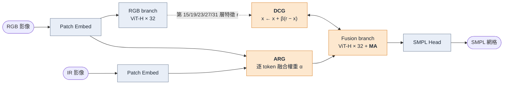

# RGBT-HMR

**Human Mesh Recovery with Reliability-Guided RGB-Infrared Fusion**

在夜間或低照度的場景，RGB 影像常常看不清楚人，熱紅外線（IR）影像卻還能拍到完整輪廓。
該專案能同時使用 RGB 模態 和 IR 模態 和 RGB-IR pair 作為輸入。

- **輕量**：HMR2.0 整個凍結（670M 參數），只額外訓練 **5.67M** 參數（不到 1%），發佈權重 23 MB。
- **按可靠度融合**：每個 patch 自行判斷 RGB 和 IR 哪一邊比較可信，而不是整張圖用同一個比例。
- **輸入有彈性**：RGB+IR、只有 IR、只有 RGB 都能跑；只有 RGB 時輸出和原本的 HMR2.0 完全相同。

## 架構



藍色是凍結的 HMR2.0，橘色是我們加上的部分。兩條分支共用同一組 ViT-H 權重。

| 模組 | 作用 | 參數量 |
|---|---|---|
| **ARG** Adaptive Reliability Gate | 進入 encoder 前，為每個 token 預測 IR 權重 α，對 RGB 和 IR token 做凸組合 | 1.32M |
| **MA** Modality Adapter | 放在 fusion branch 後 16 層，以有上限的小幅殘差，補償凍結 ViT 看到 IR 特徵時的落差 | 2.68M |
| **DCG** Deep Cross-modal Gate | 在 5 個深層位置，依 β 把融合特徵往 RGB branch 的同層特徵拉近 | 1.67M |

ARG 和 DCG 都是凸組合，輸出一定落在兩組真實特徵之間，凍結的 SMPL head 不會看到它沒見過的數值。
DCG 一開始的 β 約 0.018，幾乎不改動特徵，訓練時才慢慢學會什麼時候該參考 RGB。
單一模態輸入時不會經過 ARG、DCG，也不會執行 RGB branch。

## 結果

| 輸入 | 2D-MPJPE (px) ↓ | PCK@0.05 ↑ | 3D-MPJPE (mm) ↓ | PA-MPJPE (mm) ↓ |
|---|---|---|---|---|
| LLVIP RGB+IR | **10.51** | **78.99** | **123.22** | **69.62** |
| LLVIP 只有 IR | 12.68 | 75.27 | 128.86 | 70.67 |
| LLVIP 只有 RGB（= HMR2.0） | 15.55 | 64.12 | 143.55 | 77.17 |
| OTP2 只有 IR | 6.21 | 88.14 | 94.22 | 59.54 |

熱影像資料集沒有動作捕捉的 3D 真值，3D 指標是對 SMPLify 偽標註（pGT）計算的；root 為雙髖中點，焦距 5000。

## 快速開始

### 1. 安裝

測試環境：Python 3.7、PyTorch 1.13.1 + CUDA 11.7、RTX 4090（24 GB）。

```bash
conda create -n rgbt-hmr python=3.7 -y && conda activate rgbt-hmr
pip install torch==1.13.1+cu117 torchvision==0.14.1+cu117 --extra-index-url https://download.pytorch.org/whl/cu117
pip install numpy==1.21.6 scipy==1.7.3 opencv-python pyyaml tqdm einops timm==0.6.13 yacs \
            smplx==0.1.28 chumpy torchgeometry==0.1.2 pycocotools tensorboard \
            scikit-image==0.17.2 joblib pytorch-lightning==1.9.5
pip install pyrender trimesh   # 只有 demo 需要
```

### 2. 下載權重與 SMPL

| 放到 | 從哪裡拿 |
|---|---|
| `weights/main/model_final.pt` | 本 repo 的 [Releases](https://github.com/WayneChiu0131/RGBT-HMR/releases) |
| `weights/hmr2/epoch=35-step=1000000.ckpt` | [4D-Humans](https://github.com/shubham-goel/4D-Humans) 的 HMR2.0 checkpoint |
| `data/smpl/SMPL_{NEUTRAL,MALE,FEMALE}.pkl` | [SMPL 官網](https://smpl.is.tue.mpg.de/)（需註冊） |

發佈權重只有我們訓練的三個模組，載入時會自動從 HMR2.0 checkpoint 補上 backbone 和 head。

### 3. 設定資料路徑

```bash
cp configs/paths/example.yaml configs/paths/local.yaml
```

在 `local.yaml` 填入 `LLVIP_ROOT`、`LLVIP_VISIBLE_ROOT`、`OTP2_DATASET_ROOT`、`OTP2_ROOT`。LLVIP 的資料夾長這樣：

```
LLVIP/
├── infrared/{train,test}/*.jpg   # 熱影像
├── visible/{train,test}/*.jpg    # 對齊的 RGB
└── annotations/                  # LLVIP-Pose 2D 標註：train_llvip.json、test_llvip.json
```

所有指令都要在專案根目錄執行。

## 評估

```bash
bash scripts/eval_main.sh
```

會跑完上表四種設定，結果寫到 `eval_results/main/`。只想跑一種：

```bash
python tools/eval_2d_mu.py --dataset llvip --eval_mode rgb_ir --eval_3d \
    --checkpoint weights/main/model_final.pt \
    --train_cfg  configs/train/main/s5_dcg.yaml
```

`--eval_mode` 可選 `rgb_ir`、`ir_only`、`rgb_only`。

## 訓練

```bash
bash scripts/train_main.sh
```

分五個階段，依序接續，每階段 10k 步、batch size 8，一張 4090 約 1.5 小時：

| 階段 | 訓練的模組 | 資料 |
|---|---|---|
| S1 `s1_arg` | ARG | LLVIP RGB+IR |
| S2 `s2_ma` | ARG + MA | LLVIP，RGB+IR / 只有 IR / 只有 RGB = 0.6 / 0.3 / 0.1 |
| S3 `s3_frozen_gate` | MA（ARG 凍結） | LLVIP 0.6 + OTP2 0.4 |
| S4 `s4_refine` | 同 S3，再訓練一輪 | 同 S3 |
| S5 `s5_dcg` | DCG（其他全部凍結） | LLVIP RGB+IR |

監督訊號是 2D 關鍵點加上 pGT 的 SMPL 參數。訓練結束會自動匯出 `logs/main/model_final.pt`。

注意：每個 checkpoint 約 2.7 GB，五個階段共需約 40 GB 磁碟。訓練沒有固定亂數種子，重訓的數字會和上表略有差異。

pGT 是怎麼產生的，請見 [docs/pgt.md](docs/pgt.md)。

## Demo

```bash
python tools/demo_mu.py \
    --checkpoint weights/main/model_final.pt \
    --train_cfg configs/train/main/s5_dcg.yaml \
    --dataset LLVIP --mode rgb_ir \
    --image_folder <LLVIP 熱影像資料夾> \
    --bbox_file <bbox json> \
    --output_folder demo_output/LLVIP/rgb_ir
```

`--bbox_file` 的格式是 `{"影像檔名": [[x1, y1, x2, y2], ...]}`。`rgb_ir` 模式會到 `LLVIP_VISIBLE_ROOT/test/` 找同名的 RGB 影像。

## 專案結構

```
configs/train/main/   五個訓練階段的設定檔
configs/paths/        資料路徑（local.yaml 自己建立）
models/multimodal/    ARG、MA、DCG 的實作
tools/                評估、demo、權重匯出、pGT 生成
scripts/              一鍵訓練 / 評估
```

程式裡的名字和論文不同：ARG 是 `per_token_conf_mlp`，MA 是 `body_adapters`，DCG 是 `xmodal_deep_adapters`。

## 致謝

本專案建立在 [SPIN](https://github.com/nkolot/SPIN) 和 [4D-Humans](https://github.com/shubham-goel/4D-Humans) 之上，
設計參考了 [MMPedestron](https://github.com/BubblyYi/MMPedestron)、[BAT](https://github.com/SparkTempest/BAT) 和 [ViPT](https://github.com/jiawen-zhu/ViPT)，
SMPLify 的姿態先驗來自 [SMPLify-X](https://github.com/vchoutas/smplify-x)。
